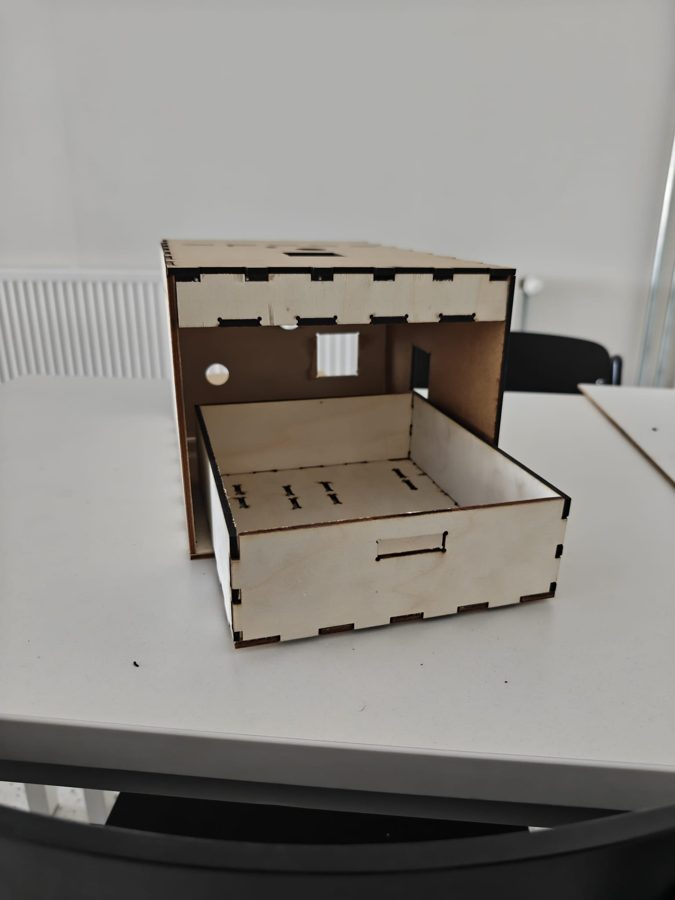
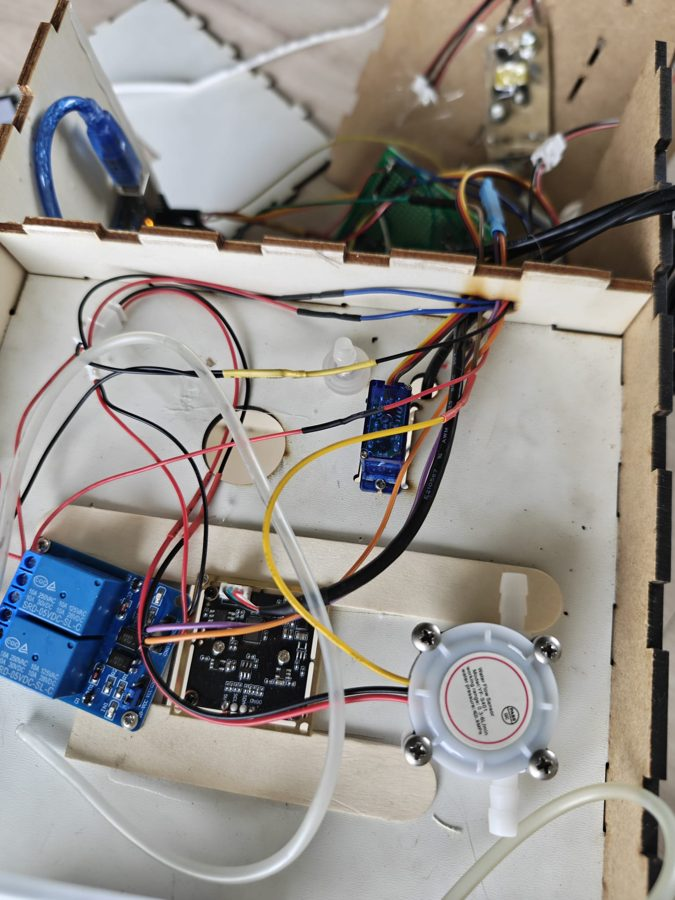
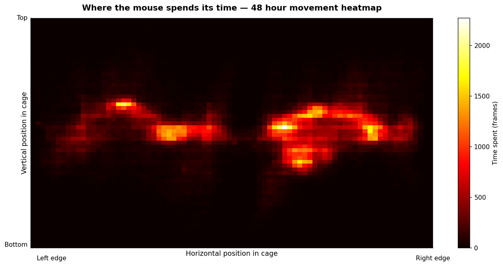
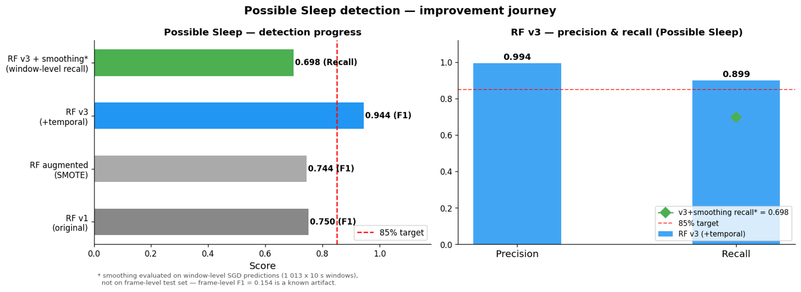
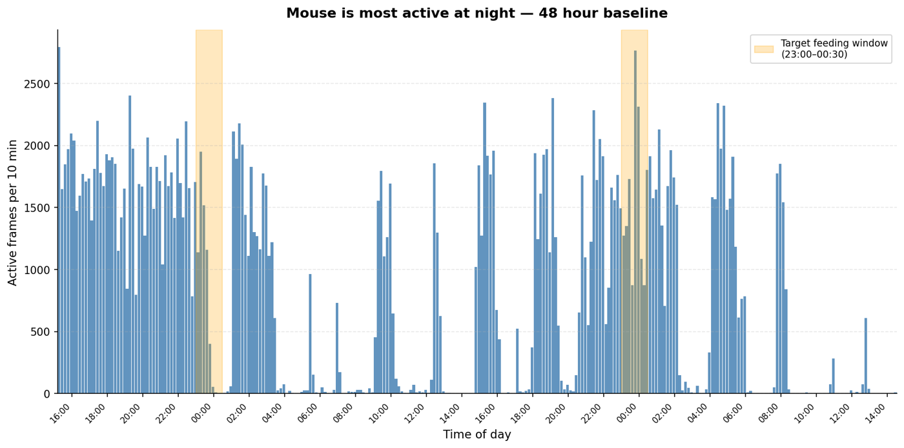
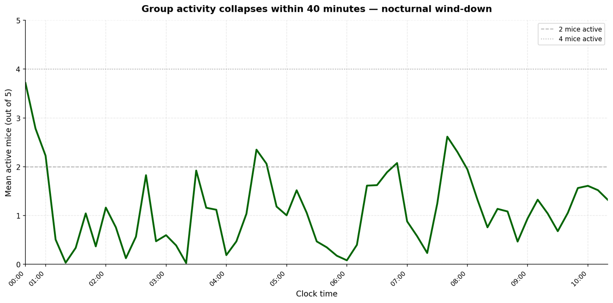
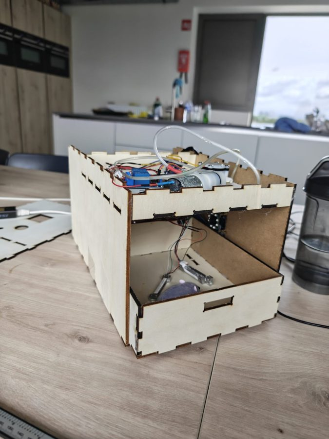
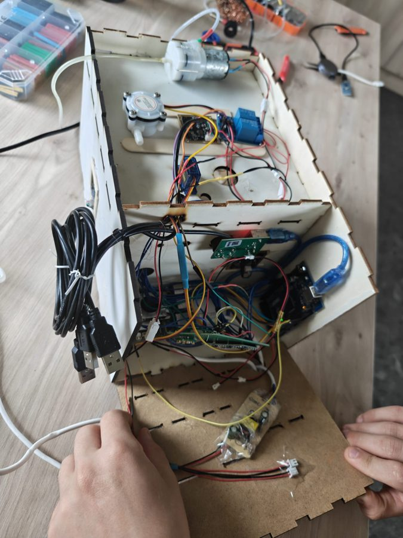

# Intelligent IVC Cage — Computer-Vision Behaviour Monitoring

**Team project · Howest University of Applied Sciences, Industry Project (Semester 4, 2026) · built for an external research client**

Laboratory mice live in individually ventilated cages (IVCs). Most of what they do there goes unrecorded: when they sleep, how active they are at night, whether they pace repetitively. Our three-person team built a prototype "smart" IVC: a sensor-instrumented cage with precision feeding and water dosing, metabolic gas sensing, cameras, a Raspberry Pi edge device and a web dashboard.

I was the team's **AI & ML Lead**. I owned the **camera-based pipeline**: detecting mice in infrared footage, tracking them, and turning their movement into behavioural states. I also worked on the physical prototype.

> This repository is a **portfolio summary of my part** of the project. The full team codebase is in a private repository ([MustafazadaAghasalim/industryprojectfinal](https://github.com/MustafazadaAghasalim/industryprojectfinal), access on request), so nothing here is a copy of the team's code. Contributions are separated by person [below](#team-and-credits).

  
  
  

---

## My role

**AI & ML Lead, camera-based detection and behaviour analysis.**

- Prepared and annotated image data, then trained, compared and fine-tuned the YOLO mouse detector
- Built the feature-extraction, behaviour-classification and temporal-smoothing pipeline on top of the detections
- Tested detection and classification outputs, and documented where the evaluation is weak
- Contributed to the physical prototype: SVG files for the laser-cut enclosure, plus help with 3D-printed parts

Not mine: the dashboard, backend, firmware, sensor stack, the sensor-based behaviour classifier, and deployment of the models onto the Raspberry Pi. See [Team and credits](#team-and-credits).

## System overview

```mermaid
flowchart LR
    CAM["IR camera / recorded footage<br/>(grayscale, 15 fps)"] --> DET["YOLOv8n mouse detector<br/>(fine-tuned on real cage frames)"]
    DET --> TRK["Hungarian-assignment tracker<br/>persistent IDs per mouse"]
    TRK --> FEAT["Per-frame features<br/>displacement · rolling stats · motion area<br/>3×3 cage zone · quiet streak · 30 s context"]
    FEAT --> RF["Random Forest<br/>Wake/Active · Quiet/Rest · Possible Sleep"]
    RF --> SMO["Temporal smoothing<br/>(sleep induction / persistence rules)"]
    SMO --> OUT["Per-interval summary<br/>state %, dominant zone,<br/>wall-hugging ratio, stereotypy"]
    OUT -.->|"integrated by teammate"| PI["On-Pi inference service<br/>→ team dashboard"]
```

Before YOLO, the first version of the pipeline located the mouse with OpenCV frame differencing (frame diff → blur → threshold → largest contour). That version produced the 48-hour single-mouse analysis below. YOLO replaced it for multi-mouse footage, where frame differencing cannot keep individual animals apart.

## AI / ML pipeline

**1. Data preparation and annotation**
- **Pre-training data:** a Roboflow mouse dataset with 5,314 training, 368 validation and 262 test images. Every split was converted to 3-channel grayscale, because the deployment camera is infrared and the model must not learn colour cues.
- **IR-style augmentation (training split only):** two extra copies of each image with brightness/contrast drift, gamma, CLAHE, sensor noise, motion blur and JPEG artefacts (Albumentations). That gives 15,942 training images. Validation and test sets were never augmented.
- **Real-cage set:** the pre-trained model pre-labelled frames extracted from the client's cage footage. I corrected the boxes in Roboflow instead of drawing them from scratch, giving 141 train / 40 val / 20 test images.

**2. Object detection** (Ultralytics, Colab T4)
- Trained YOLOv8n and YOLO11n under identical settings, with checkpoints saved to Drive and auto-resume after Colab disconnects.
- Fine-tuned both on the real-cage set with a frozen backbone (`freeze=10`) and compared them on the same held-out split. **YOLOv8n was selected** (results below) and exported to ONNX.

**3. Tracking**
- Detections are matched to existing tracks with the Hungarian algorithm (`scipy.optimize.linear_sum_assignment`) on centroid distance, using a distance gate and a lost-frame timeout. Each mouse keeps a stable ID (A, B, C…).
- Video timestamps are read from the camera's on-screen overlay with Tesseract OCR, so outputs align with clock time.

**4. Feature engineering**
- 16 features per frame: displacement, smoothed movement, rolling mean/std of distance and motion area, 3×3 cage-zone index, current quiet streak, interaction terms, and three 30-second context features (longest quiet streak in the window, % inactive, number of activity transitions).
- Rule-based ethology metrics: **thigmotaxis** (share of time in perimeter zones), **stereotypy** (sustained high movement within a ≤ 10 px spread), and for groups, active-animal count and mean inter-animal distance.

**5. Classification**
- States are first defined by explicit rules: Wake/Active above 2.5 px/frame of smoothed movement, Possible Sleep after ≥ 30 s of continuous inactivity, Quiet/Rest otherwise.
- A Random Forest (100 trees, balanced class weights) is trained on these rule-derived labels, so it can run frame-by-frame in real time with the 30-second context built in. Three versions: v1 (9 features) → v2 (13; a SMOTE-augmented variant didn't help) → **v3 (16, with temporal context)**.
- **Temporal smoothing:** three or more consecutive Quiet windows become Possible Sleep, and short active blips inside a sleep bout are absorbed into it.
- **Experimental:** an online SGD classifier that learns from the RF's output per cage, plus an RF + SGD ensemble. I measured their agreement with the RF over time. They are exploratory, not part of the main output.

**6. Validation and testing**
- Held-out test splits for every detector run, a qualitative check on raw cage frames, and FPS/latency benchmarks on Colab, including ONNX Runtime on CPU.
- For the classifier: per-class F1, confusion matrices, a threshold sweep, and a per-mouse comparison of RF v3 against the threshold rules on the five-mouse recording.

## Results and evaluation

### Mouse detection

| Model | Training data | Test set | mAP50 | mAP50-95 | Precision | Recall |
|---|---|---|---:|---:|---:|---:|
| YOLOv8n (pre-trained) | Roboflow set, augmented | 262 images | 0.969 | 0.770 | 0.946 | 0.931 |
| YOLO11n (pre-trained) | Roboflow set, augmented | 262 images | 0.971 | 0.778 | 0.967 | 0.924 |
| **YOLOv8n (fine-tuned)** | real cage frames | 20 images / 45 mice | **0.907** | **0.459** | 0.944 | 0.822 |
| YOLO11n (fine-tuned) | real cage frames | 20 images / 45 mice | 0.878 | 0.437 | 0.966 | 0.756 |

How to read these:
- **The real-cage numbers are what matter, and the test set is tiny** (20 images). Treat them as indicative, not precise. The frames come from continuous video, so near-duplicates across splits can inflate the scores.
- **Domain shift was real.** Run on 131 raw cage frames, the pre-trained detector produced only 41 boxes, despite near-0.97 mAP50 on its own test set. That is why the fine-tuning step exists. After fine-tuning, both models detected a mouse in all 30 sampled raw frames (a qualitative spot check, not a metric).
- mAP50-95 ≈ 0.46 means the boxes are fairly loose. That is acceptable here, because only the centroid feeds the tracker and features.
- Speed on a Colab T4 GPU: ~64 FPS (YOLOv8n, PyTorch). ONNX Runtime on the Colab CPU: ~7.5 FPS. Edge latency on the Raspberry Pi was measured by a teammate during deployment.

### Behaviour classification

- Adding the temporal-context features raised **Possible Sleep F1 from 0.750 (RF v1) to 0.944 (RF v3)**. Wake/Active and Quiet/Rest were already ≥ 0.98.
- **Important caveat:** these scores measure how well the Random Forest **reproduces the rule-generated labels**. They are not accuracy against human-annotated behaviour. Several features overlap with the labelling rules, and the split is a random 80/20 over frames from one recording, so frames neighbouring test frames sit in training. Expect the real-world figure to be lower. After smoothing, window-level sleep recall was 0.698.
- We had **no expert-labelled behaviour data**, so the system is **not scientifically or clinically validated**. Its outputs are activity indicators, not diagnoses.

### Example outputs

| 48 h single mouse, activity per 10 min | 9.8 h, five mice: active animals over time |
|---|---|
|  |  |

Activity peaks during the dark phase, as expected for nocturnal animals. Shaded bands mark the client's target feeding window. These are pipeline outputs on single recordings, not biological findings.

## Tech stack

| Area | Tools |
|---|---|
| Detection | Ultralytics YOLOv8n / YOLO11n (PyTorch), ONNX export |
| Data and annotation | Roboflow (dataset, annotation, export), Albumentations |
| Vision | OpenCV, Tesseract OCR (pytesseract) |
| Tracking | SciPy (Hungarian assignment) |
| ML | scikit-learn (Random Forest, SGDClassifier), imbalanced-learn (SMOTE experiment) |
| Data and plots | pandas, NumPy, Matplotlib |
| Compute | Google Colab (T4 GPU), local Python 3 |

## Hardware / physical prototype

  
  

The cage housing is a laser-cut plywood box with finger joints, a pull-out bottom drawer and a separate electronics bay for the pump, flow sensor, relays and microcontroller. I prepared SVG files for the laser cutter and helped with the 3D-printed parts. The sensors, actuators, wiring and firmware were built by teammates.

## Limitations

- **No ground-truth behaviour labels.** The classifier learns rule-defined states, so its errors are bounded by the rules. Sleep inferred from movement alone cannot be told apart from quiet wakefulness.
- **Small real-domain detector test set** (20 images, one camera setup). Performance under other cages, bedding, lighting or camera angles is unknown.
- **Possible leakage** from random frame-level splits, for both the detector and the classifier. A split by recording session or time block would give more honest numbers.
- **Pixel thresholds are tuned to one camera geometry.** The movement thresholds (px/frame) and zone grid would need recalibrating for a different setup.
- **Identity tracking is distance-only.** Huddled or overlapping mice can swap IDs, and there is no appearance model.
- **Single-session data.** The analyses are based on one 48 h single-mouse recording and one 9.8 h five-mouse recording.

## Team and credits

Industry Project, Howest University of Applied Sciences (2026), team of three:

| Team member | Main contributions (from the project repository) |
|---|---|
| **Aghasalim (Salim) Mustafazada** | Full-stack platform: FastAPI backend, React dashboard, Raspberry Pi deployment and camera streaming, Arduino firmware and sensor/actuator integration, the sensor-based behaviour classifier and anomaly detector, and integrating my detector and RF v3 model into the on-Pi inference service |
| **Hadi Hleihel** | Backend development and system architecture |
| **Gražvydas Stalmokas** (me) | Camera-based AI/ML pipeline described above; physical prototyping (laser-cut enclosure SVGs, 3D printing) |

The overall system design, client communication and hardware integration were team efforts. The original repository and its MIT licence belong to the team.

---

Contact: [github.com/StalmokasGrazvydas](https://github.com/StalmokasGrazvydas)
